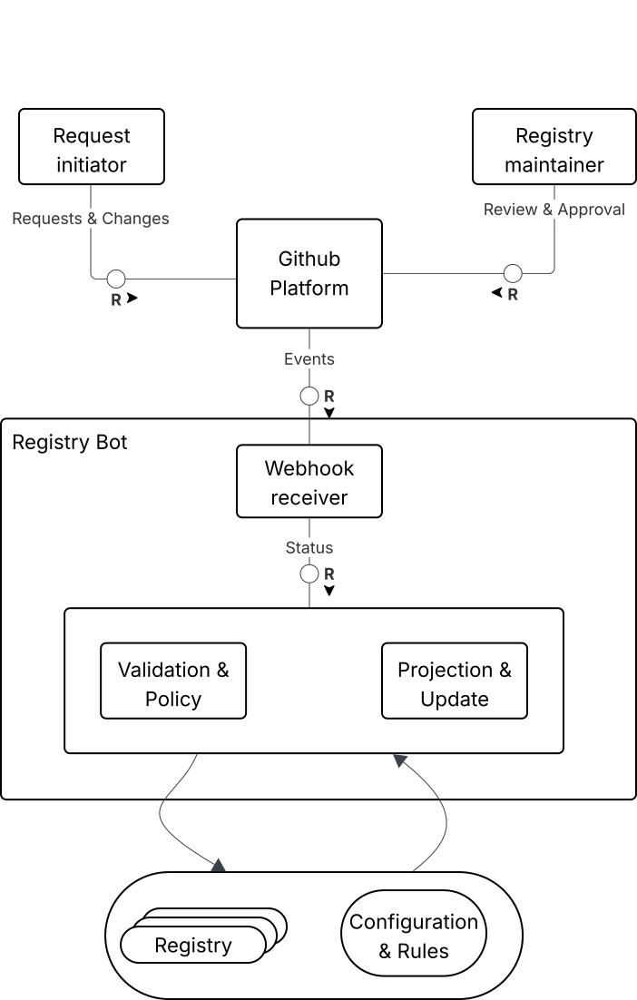

# Registry Bot

Registry Bot is a configuration-driven GitHub App built with Probot. It automates registry request handling in a target repository by validating GitHub issues, creating registry YAML pull requests, routing approvals, and merging safe changes when the repository rules allow it.

The bot is generic. Repository-specific behavior is configured in the target repo:

```text
.github/registry-bot/config.yaml or config.yml
.github/registry-bot/config.js           # optional runtime hooks
.github/ISSUE_TEMPLATE/*.yml             # request forms
.github/registry-bot/request-schemas/*   # JSON schemas
```

## What the bot does

- Parses GitHub Issue Forms into request data.
- Validates requests with JSON Schema and optional repo hooks.
- Checks duplicate registry entries before creating PRs.
- Creates branches, YAML files, and pull requests for valid requests.
- Routes manual approvals through configurable labels and assignees.
- Supports parent-owner and contact-owner approval gates.
- Supports `onApproval` hooks for automatic approval decisions.
- Handles standalone direct registry PRs.
- Keeps workflow state labels exclusive, for example `Requester Action`, `CPA Action`, `Parent Owner Action`, `Approved`, or `Rejected`.
- Uses a sequential direct-PR queue to avoid parallel registry updates and CI overload.
- Can approve pending workflow runs only for safe registry-only PRs with an existing trust signal.

## High-level architecture

```text
GitHub Webhook
  -> Probot event facade (`events/`)
    -> Request composition root (`index.ts`)
      -> Runtime wiring (`composition/*-runtime-composition.ts`)
        -> Application workflows (`application/`)
          -> Domain logic (`domain/`)
          -> Infrastructure adapters (`infrastructure/`)
```

GitHub remains the system of record. The bot stores request state through GitHub issues, pull requests, comments, labels, reviews, and hidden metadata markers in issue bodies. The bot does not maintain a separate persistent database for request content.

## Request lifecycle

1. A requester opens an issue using a configured Issue Form.
2. The routing label selects the request type.
3. The bot parses the issue body and validates it.
4. If validation fails, the bot posts one validation comment and sets the configured requester-action label.
5. If ownership approval is required, the bot routes to the correct owner state, for example `Parent Owner Action`.
6. If validation and gates pass, the bot either:
   - creates a PR directly, or
   - routes the request to manual review, or
   - auto-approves when `onApproval` returns an approved decision.
7. The bot creates or updates labels so that only one workflow state is active at a time.

## Direct registry PR lifecycle

Standalone direct registry PRs are PRs that modify registry YAML files.

The bot:

- reads changed registry YAML files,
- resolves request type and resource name,
- runs `onApproval` file by file,
- rejects the PR if any file is rejected,
- routes to manual review if approval is unknown or incomplete,
- creates a real PR review approval for approved cases,
- merges only when approval applies to the current head and checks are green.

Green CI alone is not enough for merge.

## Workflow run approval

Some GitHub/GHES setups require maintainers to approve workflow runs for PRs from forks or contributors.

The bot may attempt to approve pending workflow runs only when all of these are true:

- the PR is open and not draft,
- the PR changes only registry YAML files,
- no workflow or bot/config code is changed,
- the PR has a trust signal:
  - `onApproval` returned `approved`, or
  - a valid current-head approval already exists.

Without a trust signal, the bot does not bypass GitHub's manual workflow approval gate.

## Configuration

Minimal target repo config:

```yaml
requests:
  systemNamespace:
    folderName: /data/namespaces
    schema: './request-schemas/system-namespace.schema.json'
    issueTemplate: '../ISSUE_TEMPLATE/1-system-namespace-request.yaml'

pr:
  branchNameTemplate: 'feat/resource-{resource}-issue-{issue}'
  titleTemplate: 'Add {type} `{resource}`'
  autoMerge:
    enabled: true
    method: squash

workflow:
  labels:
    authorAction: 'Requester Action'
    approverAction: 'CPA Action'
    parentOwnerAction: 'Parent Owner Action'
    approvalRequested: ['CPA Action']
    approvalSuccessful: ['Approved']
    approvalRejected: ['Rejected']
    autoMergeCandidate: 'auto-merge-candidate'
  approvers: ['<login-name>']
  approversPool: ['<login-name>']
```

Important fields:

| Field                      | Purpose                                                                                     |
| -------------------------- | ------------------------------------------------------------------------------------------- |
| `requests.*.folderName`    | Target folder for generated registry YAML.                                                  |
| `requests.*.schema`        | JSON schema for validation.                                                                 |
| `requests.*.issueTemplate` | GitHub issue template used for this request type.                                           |
| `requests.*.approvers`     | Request-type approvers.                                                                     |
| `requests.*.approversPool` | Request-type reviewer pool. One deterministic user is assigned, all pool users can approve. |
| `workflow.labels.*`        | Labels used for request state and approval state.                                           |
| `workflow.approvers`       | Global fallback approvers.                                                                  |
| `workflow.approversPool`   | Global fallback reviewer pool.                                                              |

## Runtime hooks

Target repositories can provide optional runtime logic in:

```text
.github/registry-bot/config.js
```

JavaScript hooks require the deployment environment variable `REGISTRY_BOT_ENABLE_JS_HOOKS=true`.
Only the exact value `true` enables loading and execution; repository configuration cannot enable them.
YAML configuration and built-in validation remain available without hooks.

Enabled hooks are trusted Node.js code with access to Node.js APIs and the worker environment.
A worker thread is not a security sandbox. Enable hooks only for trusted repository administrators;
untrusted code requires separate isolation with restricted credentials and network access.

The provided hook HTTP API and worker `fetch` deny outbound hosts unless configured in YAML:

```yaml
hooks:
  allowedHosts:
    - api.example.com
```

An omitted or empty allowlist denies outbound hook HTTP requests. An explicit `'*'` disables hostname
matching while retaining URL checks, including local IP literal checks. The allowlist does not validate
DNS resolution or restrict arbitrary Node.js network APIs. Keep credentials in deployment secret storage.

### Migrating deployments that already use hooks

Before upgrading a deployment that uses repository or organization-level `config.js`:

1. Review the hooks and configure their required hostnames under `hooks.allowedHosts`.
2. Set `REGISTRY_BOT_ENABLE_JS_HOOKS=true` in the trusted deployment's runtime environment.
3. Restart and verify hook-dependent normalization, validation, and approval behavior in development.

Without the opt-in, hook-based normalization, custom validation, and approval decisions are skipped.

Supported hooks:

| Hook                                        | Purpose                                                                |
| ------------------------------------------- | ---------------------------------------------------------------------- |
| `beforeValidate(args)`                      | Optional form normalization before validation.                         |
| `onValidate(args)` / `customValidate(args)` | Additional validation after schema projection.                         |
| `onApproval(args)`                          | Business decision for automatic approval, rejection, or manual review. |

`onApproval` can return:

```js
{ status: 'approved', message: '...' }
{ status: 'rejected', message: '...', errors: [...] }
{ status: 'unknown', approvers: ['USER'], message: '...' }
```

No response or no match means the normal review flow continues.

## Hook secrets

Hook secrets are provided through environment variables prefixed with `HOOK_SECRET_`.

Example:

```text
HOOK_SECRET_REMOTE_LOOKUP_URL=https://example.invalid
HOOK_SECRET_REMOTE_LOOKUP_AUTH=Bearer ...
```

Inside `config.js`:

```js
const lookupUrl = config.getSecret('REMOTE_LOOKUP_URL');
const lookupAuth = config.getSecret('REMOTE_LOOKUP_AUTH');
```

The `HOOK_SECRET_` prefix is removed before the value is exposed to the hook. Secrets are scoped to hook execution and should not be stored in target repo config files.

## External service validation and data scope

External lookups are optional and target-repo controlled through `config.js`.

A validation hook may call a remote source to check whether a submitted technical identifier exists. The lookup should be limited to the minimum required fields.

Example:

```text
/resources?$top=1&$select=id&$filter=id eq 'RESOURCE-...'
```

The hook should only use the lookup result to validate the submitted request field.

The bot does not request, read, process, or store personal data from remote validation sources, such as:

- creator,
- owner,
- responsible person,
- modifiedBy,
- contact person,
- or similar user-related fields.

The bot does not store remote response payloads. If the identifier does not exist or the lookup fails, the bot returns a validation error on the request.

Purpose: registry data quality validation, not personal data processing.

## Security boundaries

- The bot is installed as a GitHub App on target repositories.
- Hook HTTP calls should be limited to allowed hosts and HTTPS endpoints.
- Secrets are loaded from deployment environment variables, not from repository files.
- The bot does not auto-merge PRs without current-head approval and green checks.
- The bot does not approve workflow runs for untrusted registry-only PRs without a trust signal.
- Workflow approval automation requires GitHub App `Actions: write` permission.

## Required GitHub App permissions

Minimum permissions depend on enabled features:

| Permission    | Level        | Why                                                     |
| ------------- | ------------ | ------------------------------------------------------- |
| Metadata      | Read         | Required by GitHub Apps.                                |
| Issues        | Read & write | Read issues, comments, labels, assignees, update state. |
| Pull requests | Read & write | Create reviews, update/merge/close PRs.                 |
| Contents      | Read & write | Read config/schemas and write registry YAML files.      |
| Checks        | Read         | React to CI/check results.                              |
| Actions       | Read         | Read workflow runs.                                     |
| Actions       | Write        | Only needed for workflow run approval automation.       |

## Local development

```bash
npm install
npm test
```

For integration testing, install the GitHub App on an example registry repository and configure:

```text
.github/registry-bot/config.yaml
.github/registry-bot/config.js
.github/ISSUE_TEMPLATE/*.yml
.github/registry-bot/request-schemas/*.json
```

## Operational notes

- Webhook requests are acknowledged quickly, heavier bot work may continue asynchronously in the background to avoid GitHub webhook delivery timeouts.
- The bot validates config on default-branch updates.
- Existing issues remain compatible when templates gain new required fields.
- Failed or blocked direct PR heads are skipped temporarily so the sequential queue can continue.
- Hidden markers are used for routing lock, parent approval, contact approval, and snapshot tracking.

## Architecture

### Block diagram



> Source file: [docs/Registry-bot-TAM-Block-Diagram.svg](docs/Registry-bot-TAM-Block-Diagram.svg)

### Activity diagram

Shows the flow until PR creation and auto-merge setup.


> Source file: [docs/Activity v0.svg](docs/Activity%20v0.svg)

### Sequence diagram

Shows the happy path call sequence.


> Source file: [docs/Sequence v0.svg](docs/Sequence%20v0.svg)

## Acknowledgements

- Built with [Probot](https://probot.github.io).

## Protected-base metadata review

For privileged registry review, use a workflow defined on the protected base branch with pull_request_target and a checkout pinned to the event's base SHA, with persist-credentials: false.
Set trusted-base-review: true, mode: pr, expected-base-branch, and the verified immutable expected-bot-id when automated approval is enabled.
The Action rejects forks, drafts, stale heads/base revisions, incomplete changed-file lists, rename escapes, and changes outside regular bounded data JSON/YAML files.
It fetches PR Git objects without checking out PR code and overlays only validated metadata on the protected base checkout.
Configuration, schemas, hooks, and executable code stay at the protected base revision.
The original reviewer and human-touch policies remain in effect; automated approval additionally checks the service identity and explicitly binds the review to the validated commit.
Grant contents: read and pull-requests: write, and never install or execute PR-defined code in that job.
The legacy mode remains available for ordinary read-only PR validation and existing callers.
